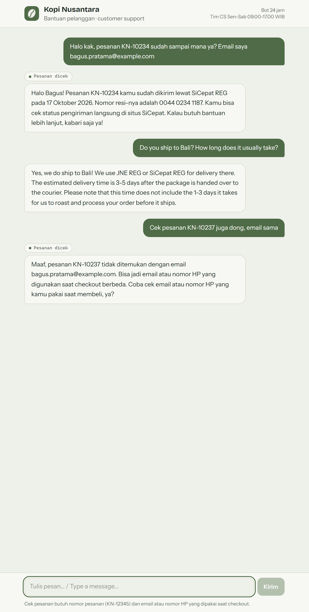

# shop-support-bot

[](https://github.com/ramaraihan12/shop-support-bot/actions/workflows/ci.yml)

A support chatbot for a small online shop. The demo shop is a made-up Indonesian coffee roaster, Kopi Nusantara. The bot answers questions from the shop's policy docs, checks orders and stock, opens tickets, and hands the chat to a human when the customer asks or is clearly upset. It replies in Bahasa Indonesia or English, whichever the customer writes in.



That conversation ran on a local `qwen3.5-9b` through Ollama. Note the last turn: the order belongs to someone else, so the bot says it can't find it and doesn't reveal anything.

## How it works

- Policy docs in `content/policies` are split into chunks, embedded and stored in Postgres with pgvector. Each turn the bot pulls the closest sections into the prompt.
- Order status, stock and ticket creation are tool calls against Postgres. Tool inputs are checked with Zod.
- An order lookup needs the order number plus the email or phone used at checkout. If they don't match, the answer is the same as for an order that doesn't exist.
- Handoff and language are detected before the model runs, and there is a small in-memory rate limit per session.
- The web chat streams over the AI SDK UI message protocol. The Telegram webhook uses the same `respond` function.
- `/admin` lists conversations and tickets behind basic auth.

## Stack

- Next.js 16 (App Router), TypeScript strict, Tailwind
- Vercel AI SDK 7 with Ollama (default), OpenAI, Google or Anthropic
- Postgres + pgvector, Drizzle ORM, Zod
- Vitest, ESLint, pnpm

## Run it

You need Node 24, pnpm, Postgres with pgvector, and Ollama with a chat model and `qwen3-embedding:0.6b`.

```sh
pnpm install
cp .env.example .env        # set DATABASE_URL, AI_MODEL, ADMIN_PASSWORD
pnpm db:migrate
pnpm db:seed                # fictional products, customers, orders
pnpm ingest                 # embed the policy docs
pnpm dev
```

Open http://localhost:3000. Try order `KN-10231` with `rina.wulandari@example.com`.

Or with Docker, which starts Postgres, runs the setup and serves on port 3000 (Ollama stays on the host):

```sh
docker compose up --build
```

Settings are in `.env.example`. To use another provider set `AI_PROVIDER` and the matching API key. Embeddings are stored at 1024 dimensions, so if you change the embedding model, run `pnpm ingest` again.

### Telegram

1. Make a bot with @BotFather and put the token in `TELEGRAM_BOT_TOKEN`.
2. Set `TELEGRAM_WEBHOOK_SECRET` to any string of letters, digits, `_` or `-`.
3. Expose the app over https (ngrok or similar) and run `pnpm telegram:webhook https://<your host>`.

## Tests

```sh
pnpm test
```

These run offline with the AI SDK mock model. The Postgres tests are skipped unless `TEST_DATABASE_URL` is set. They migrate and reseed that database, so use a scratch one.

## Notes

- The rate limiter lives in memory, so it only works for a single instance.
- A 9B model on a laptop GPU takes a few seconds per reply, and more when it makes a tool call.
- Replies are only as good as the policy docs. There is no check that an answer actually came from a retrieved section.
- Next would be an evals script that replays a set of questions and flags wrong answers.
